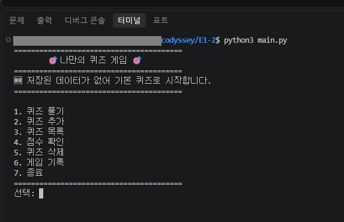
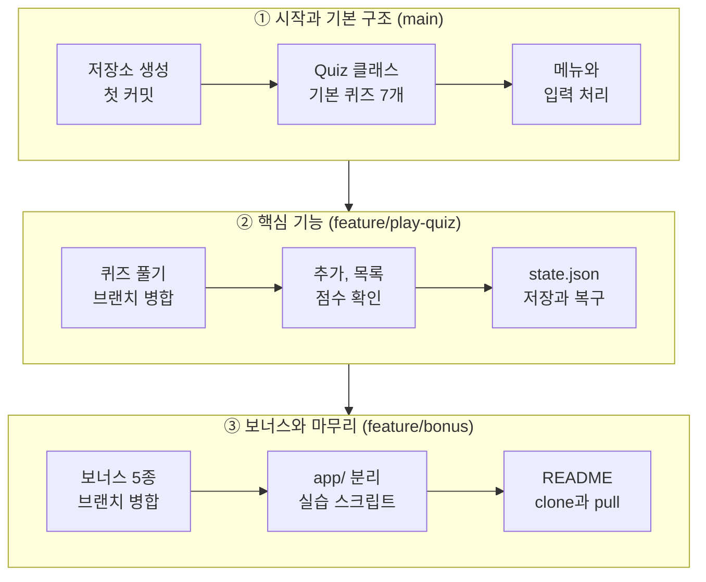
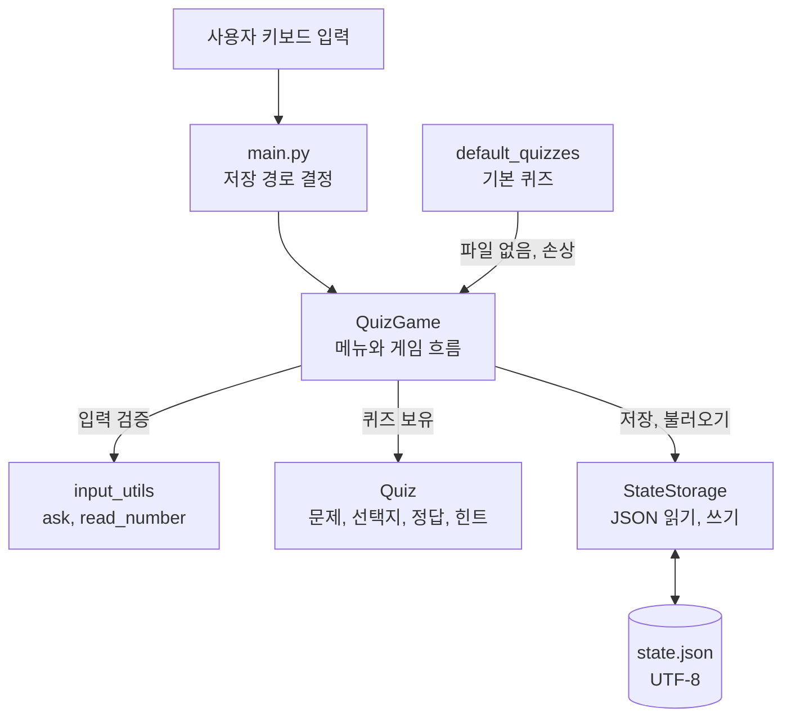

# 🎯 나만의 퀴즈 게임 (E1-2)

터미널에서 동작하는 4지선다 퀴즈 게임을 Python 클래스로 만들고, `state.json`으로 데이터를 유지하며, Git 브랜치·병합·clone·pull로 이력을 관리한 미션 결과물입니다.

- GitHub: https://github.com/ilililililil4319/E1-2
- 미션: 컴퓨터에게 명령 내리는 말(파이썬) 처음 배우기 — 올인원 1기 입학 연수 E1-2
- 실행 로그: [docs/logs/](docs/logs/)
- 스크린샷: [docs/screenshots/](docs/screenshots/)
- 환경 세팅: [docs/SETUP.md](docs/SETUP.md)



## 목차

1. [프로젝트 소개](#1-프로젝트-소개)
2. [핵심 질문](#2-핵심-질문)
3. [프로젝트 개요 및 산출물 구성](#3-프로젝트-개요-및-산출물-구성)
4. [폴더 구조 (파일 구조)](#4-폴더-구조-파일-구조)
- [용어 설명 (초보자를 위한 참고)](#용어-설명-초보자를-위한-참고)
5. [기술 스택 및 실행 환경](#5-기술-스택-및-실행-환경)
6. [사용 자료·이미지 및 출처](#6-사용-자료이미지-및-출처)
7. [검증 방법 및 핵심 개념 요약](#7-검증-방법-및-핵심-개념-요약)
8. [전체 작업 순서 (STEP)](#8-전체-작업-순서-step)
9. [작업 흐름도](#9-작업-흐름도)
10. [구조도](#10-구조도)
11. [핵심 실습 결과](#11-핵심-실습-결과)
12. [보너스 과제](#12-보너스-과제)
13. [로컬 실행 방법](#13-로컬-실행-방법)
14. [환경 변수 및 설정 (데이터 파일 설명)](#14-환경-변수-및-설정-데이터-파일-설명)
15. [실습 중 발생한 오류와 해결](#15-실습-중-발생한-오류와-해결)
16. [AI(Claude) 사용 로그 요약](#16-aiclaude-사용-로그-요약)
17. [기능요구사항 대비 결과](#17-기능요구사항-대비-결과)
18. [결론 및 한계점](#18-결론-및-한계점)
19. [보안 유의사항](#19-보안-유의사항)
20. [출처 및 라이선스 유의사항](#20-출처-및-라이선스-유의사항)
21. [기타](#21-기타)

---

## 1. 프로젝트 소개

| 항목 | 내용 |
| --- | --- |
| 미션 목표 | 문법을 "아는 것"을 넘어, 입력→처리→출력→저장이 이어진 프로그램 하나를 처음부터 끝까지 완성한다 |
| 핵심 도구 | Python 3 (표준 라이브러리만), Git, GitHub |
| 핵심 가치 | 역할별 클래스 분리, 어떤 입력에도 죽지 않는 프로그램, 껐다 켜도 남는 데이터, 기능 단위로 남긴 Git 이력 |

### 퀴즈 주제와 선정 이유

**주제: 개발 입문 상식 (CLI · Git · Python · Docker)**

입학 연수에서 처음 배우는 터미널 명령어, Git 명령어, Python 문법은 여러 번 직접 써 봐야 손에 익습니다.
퀴즈 게임을 만드는 과정 자체가 Python 복습이고, 완성된 게임으로 Git/CLI 명령어를 반복 학습할 수 있어서
"만들면서 공부하고, 만든 것으로 또 공부하는" 주제로 골랐습니다.

### 기능 목록

| 메뉴 | 기능 |
| --- | --- |
| 1. 퀴즈 풀기 | 문제 수 선택 → 랜덤 출제 → 정답 번호 입력(`h`로 힌트) → 정답/오답 표시 → 최종 점수(100점 만점), 최고 점수 갱신 |
| 2. 퀴즈 추가 | 문제, 선택지 4개, 정답 번호(1~4), 힌트(선택) 입력 → 즉시 저장 |
| 3. 퀴즈 목록 | 등록된 퀴즈의 문제 목록 |
| 4. 점수 확인 | 최고 점수와 그때의 정답 수 (아직 안 풀었으면 안내) |
| 5. 퀴즈 삭제 | 번호 선택 → y/n 확인 → 삭제 후 즉시 저장 (0은 취소) |
| 6. 게임 기록 | 최근 10회 기록(날짜/시간, 문제 수, 정답 수, 힌트, 점수)과 평균 점수 |
| 7. 종료 | 저장 후 종료 |

## 2. 핵심 질문

미션의 "스스로 설명할 수 있어야 한다" 항목과 한 줄 답입니다.

**Python 기초**

- 변수가 무엇이고 왜 쓰는가?
  → 값에 이름표를 붙여 두는 상자. 같은 값을 여러 곳에서 쓰고 바꿀 때 이름으로 부르기 위해 쓴다 (`correct += 1`).
- `int`, `str`, `bool`, `list`, `dict`의 차이는?
  → 정수 / 글자 / 참·거짓 / 순서 있는 목록 / 이름표(key)로 찾는 묶음. 퀴즈 1개는 `dict`, 선택지는 `list`, 정답 번호는 `int`로 저장했다.
- `if/elif/else`로 조건에 따라 다르게 동작하려면?
  → 정답이면 "정답", 아니면 "오답"을 출력하는 `if quiz.is_correct(...) / else` 구조로 썼다.
- `for`와 `while`의 차이와 선택 기준은?
  → `for`는 횟수가 정해진 반복(문제 목록 돌기), `while`은 조건이 만족될 때까지 반복(올바른 입력이 올 때까지 다시 묻기).
- 함수의 매개변수와 반환값은?
  → `read_number(prompt, minimum, maximum)`처럼 필요한 값을 받아(매개변수) 검증된 숫자를 돌려준다(반환값).

**클래스와 객체**

- 클래스가 무엇이고 왜 쓰는가?
  → 데이터(속성)와 그 데이터를 다루는 기능(메서드)을 한 묶음으로 만드는 설계도. 퀴즈·게임·저장의 책임을 나누려고 썼다.
- `__init__`과 `self`의 역할은?
  → `__init__`은 객체가 만들어질 때 자동 실행되어 속성을 채우고, `self`는 "지금 만들어지는(사용 중인) 그 객체 자신"을 가리킨다.
- 속성과 메서드는?
  → `Quiz.question/choices/answer`가 속성, `display()/is_correct()`가 메서드.

**파일 입출력**

- 파일을 열고, 읽고, 쓰는 과정은?
  → `with open(경로, 모드, encoding="utf-8") as f:`로 열고 `json.load(f)` / `json.dump(data, f)`로 읽고 쓴다. `with`가 끝나면 자동으로 닫힌다.
- JSON이 무엇이고 왜 쓰는가?
  → `{"키": 값}` 형태의 글자 파일. 사람이 읽을 수 있고 Python `dict/list`와 1:1로 바뀌어 저장에 편하다.
- `try/except`로 오류 처리는?
  → `int("abc")`의 `ValueError`, 손상된 파일의 `JSONDecodeError`, `Ctrl+C`의 `KeyboardInterrupt`를 잡아 안내 후 계속/안전 종료한다.

**Git 기초**

- Git이 무엇이고 왜 필요한가?
  → 파일의 변경 이력을 저장하는 도구. 언제 무엇을 왜 바꿨는지 남기고, 되돌리고, 나눠서 작업한 뒤 합칠 수 있다.
- `init/add/commit/push/pull/checkout/clone`은?
  → 저장소 만들기 / 커밋할 파일 담기 / 이력 저장 / 원격에 올리기 / 원격에서 받아 합치기 / 브랜치 이동 / 원격 저장소 통째로 복제.
- 브랜치 생성과 병합은?
  → `git checkout -b feature/play-quiz`로 갈래를 만들어 작업하고 `git checkout main` → `git merge --no-ff feature/play-quiz`로 합쳤다.
- clone 하고 pull로 변경을 가져오기는?
  → 복제본(`E1-2-copy`)에서 README를 고쳐 push하고, 원래 폴더에서 `git pull`로 받아 반영을 확인했다 ([13_clone_pull.md](docs/logs/13_clone_pull.md)).

## 3. 프로젝트 개요 및 산출물 구성

| 최종 결과물 | 저장소 위치 |
| --- | --- |
| 퀴즈 게임 실행 파일 | [main.py](main.py) |
| 게임 코드 (클래스 3개) | [app/](app/) |
| 데이터 파일 | `state.json` (실행 시 루트에 자동 생성, Git 제외) |
| 실습 스크립트 | [scripts/](scripts/) |
| 실행 로그 (명령 + 출력) | [docs/logs/](docs/logs/) |
| 스크린샷 | [docs/screenshots/](docs/screenshots/) |
| 환경 세팅 문서 | [docs/SETUP.md](docs/SETUP.md) |

## 4. 폴더 구조 (파일 구조)

```
E1-2/
├── README.md              # 기술 문서 (이 파일)
├── .gitignore             # state.json, .demo/, .env, 키 파일, 캐시 제외
├── main.py                # 시작점: 저장 경로 결정 → 게임 시작
├── app/                   # 게임 코드
│   ├── __init__.py
│   ├── quiz.py            # Quiz: 퀴즈 1개 (출력, 정답 확인, 힌트, dict 변환)
│   ├── quiz_game.py       # QuizGame: 메뉴, 풀기/추가/목록/점수/삭제/기록
│   ├── storage.py         # StateStorage: state.json 읽기/쓰기, 손상 처리
│   ├── input_utils.py     # 공통 입력 함수 (공백·빈 입력·숫자·범위 검증)
│   └── default_quizzes.py # 기본 퀴즈 7개
├── scripts/
│   ├── lib.sh             # run/try/check/note/section, 마스킹, 실패 시 [중단]
│   ├── answers.py         # 고정 시드 기준 정답 입력값 계산 (스크립트용)
│   ├── 00_env.sh          # 실행 환경
│   ├── 01_git_setup.sh ~ 18_git_history.sh   # 요구사항 하나당 스크립트 하나
│   └── run_all.sh         # 전부 순서대로 실행
└── docs/
    ├── SETUP.md           # 환경 세팅 (Windows WSL2 기준)
    ├── logs/              # 스크립트 출력 (자동)
    └── screenshots/       # 캡처
```

### 용어 설명 (초보자를 위한 참고)

| 분야 | 용어/명령 | 뜻 |
| --- | --- | --- |
| Python | 클래스 / 객체 | 설계도 / 설계도로 만든 실제 물건 |
| Python | 속성 / 메서드 | 객체가 가진 값 / 객체가 할 수 있는 일 |
| Python | `__init__`, `self` | 객체가 태어날 때 실행되는 준비 함수 / 객체 자기 자신 |
| Python | 예외(Exception) | 실행 중 생긴 문제. `try/except`로 잡아서 처리 |
| Python | JSON | 사람이 읽을 수 있는 데이터 저장 형식 (`{"키": 값}`) |
| Python | UTF-8 | 한글을 포함한 전 세계 글자를 저장하는 방식 |
| Python | 영속성 | 프로그램을 껐다 켜도 데이터가 남는 것 |
| Git | 커밋 | 지금 상태를 이력으로 저장한 한 장의 사진 |
| Git | 스테이징 (`add`) | 다음 커밋에 넣을 파일을 담아 두는 것 |
| Git | 브랜치 | 원본을 건드리지 않고 따로 작업하는 갈래 |
| Git | 병합 (`merge`) | 갈래에서 한 작업을 합치는 것 |
| Git | 원격 저장소 (`origin`) | GitHub에 있는 저장소 |
| CLI | 파이프 `\|` | 앞 명령의 출력을 뒤 명령의 입력으로 넘김 |
| CLI | `printf '1\n7\n'` | 줄바꿈이 섞인 글자를 만들어 프로그램 입력으로 보냄 |
| CLI | 종료 코드 | 0이면 성공, 0이 아니면 실패 |

## 5. 기술 스택 및 실행 환경

| 도구 | 버전 (출처: [00_env.md](docs/logs/00_env.md)) | 용도 |
| --- | --- | --- |
| OS | Windows + WSL2 Ubuntu | 실행 환경 |
| Python | 3.10 이상 (실행 로그의 실제 버전) | 게임 실행 |
| Git | 실행 로그의 실제 버전 | 버전 관리 |
| VSCode (WSL 확장) | - | 편집, 터미널 |
| 외부 라이브러리 | 없음 | 표준 라이브러리 `json`, `os`, `random`, `datetime`, `sys`만 사용 |

## 6. 사용 자료·이미지 및 출처

| 자료 | 출처 | 비고 |
| --- | --- | --- |
| 퀴즈 문제 7개 | 직접 작성 | CLI·Git·Python·Docker 기초 |
| Python 표준 라이브러리 | https://docs.python.org/3/library/ | `json`, `random` 등, 별도 설치 없음 |
| 스크린샷 | 직접 캡처 | 개인정보(아이디·컴퓨터 이름) 가림 |

외부 패키지를 쓰지 않으므로 고정할 버전이 없고, Python 3.10 이상이면 같은 결과가 나옵니다.

## 7. 검증 방법 및 핵심 개념 요약

**검증 원칙**

1. 요구사항 하나당 스크립트 하나: `scripts/NN_*.sh`가 명령을 실행하고 명령+출력을 `docs/logs/NN_*.md`에 그대로 남긴다.
2. 결과를 눈으로만 보지 않는다: `check`가 파일 내용·출력 문구를 조건으로 확인해 ✅/❌를 남기고, 실패하면 [중단]한다.
3. 다시 실행해도 같은 결과: 실습 데이터는 `.demo/`에서 매번 새로 만들고, `QUIZ_SEED`로 랜덤 순서를 고정한다.
4. 사람만 할 수 있는 확인(대화형 실행 화면, VSCode, GitHub 화면)은 스크린샷으로 남긴다.

| 핵심 질문 | 확인 결과 | 증거 |
| --- | --- | --- |
| 잘못된 입력에도 죽지 않는가 | 공백·abc·범위 밖·빈 입력은 재입력, Ctrl+C·EOF는 저장 후 종료 코드 0 | [03_input_errors.md](docs/logs/03_input_errors.md) |
| 껐다 켜도 데이터가 남는가 | 추가한 퀴즈·최고 점수가 재실행 후에도 유지 | [07_add_quiz.md](docs/logs/07_add_quiz.md), [09_score.md](docs/logs/09_score.md) |
| 파일이 망가지면? | `.bak`으로 백업 후 기본 퀴즈로 복구 | [11_state_json.md](docs/logs/11_state_json.md) |
| 클래스로 역할을 나눴는가 | `Quiz`, `QuizGame`, `StateStorage` 3개 | [10_quizgame_class.md](docs/logs/10_quizgame_class.md) |
| 브랜치·병합, clone·pull을 했는가 | `feature/play-quiz`, `feature/bonus` 병합, 복제본 push → pull 반영 | [13_clone_pull.md](docs/logs/13_clone_pull.md), [18_git_history.md](docs/logs/18_git_history.md) |

## 8. 전체 작업 순서 (STEP)

| STEP | 작업 | 증빙 |
| --- | --- | --- |
| 1 | GitHub 저장소 생성, `.gitignore`·README 첫 커밋 | [01_git_setup.md](docs/logs/01_git_setup.md) |
| 2 | `Quiz` 클래스 → 기본 퀴즈 데이터 → 메뉴·입력 처리 | [04](docs/logs/04_quiz_class.md), [05](docs/logs/05_default_quizzes.md), [02](docs/logs/02_menu.md), [03](docs/logs/03_input_errors.md) |
| 3 | `feature/play-quiz` 브랜치에서 퀴즈 풀기 → main 병합 | [06_play.md](docs/logs/06_play.md) |
| 4 | 퀴즈 추가 → 목록 → 점수 | [07](docs/logs/07_add_quiz.md), [08](docs/logs/08_list.md), [09](docs/logs/09_score.md) |
| 5 | `state.json` 저장/불러오기, 손상 복구, Ctrl+C·EOF 처리 | [11_state_json.md](docs/logs/11_state_json.md) |
| 6 | `feature/bonus` 브랜치에서 보너스 5종 → main 병합 | [14](docs/logs/14_bonus_random_count.md)~[17](docs/logs/17_bonus_history.md) |
| 7 | 코드를 `app/`로 분리, 실습 스크립트 추가 | [10_quizgame_class.md](docs/logs/10_quizgame_class.md) |
| 8 | README 작성, clone/pull 실습 | [12_readme.md](docs/logs/12_readme.md), [13_clone_pull.md](docs/logs/13_clone_pull.md) |
| 9 | 전체 Git 이력 확인 | [18_git_history.md](docs/logs/18_git_history.md) |

## 9. 작업 흐름도



## 10. 구조도



**설계 노트**

- `QuizGame`은 "무엇을 할지"만 알고, 파일을 어떻게 읽고 쓰는지는 `StateStorage`가 맡는다. 저장 방식을 바꿔도 게임 코드는 그대로다.
- 모든 입력은 `input_utils.ask()`를 지나간다. 공백 제거·재입력 규칙이 한 곳에 있어 메뉴·정답·추가 화면이 같은 방식으로 동작한다.
- `Ctrl+C`/EOF는 각 입력 함수가 아니라 `QuizGame.run()` 한 곳에서 잡아 "저장 후 종료"를 보장한다.
- 저장은 임시 파일에 먼저 쓰고 `os.replace`로 바꿔치기한다. 저장 도중 꺼져도 기존 `state.json`이 반쯤 쓰인 채 남지 않는다.

## 11. 핵심 실습 결과

아래 발췌는 실행 로그에서 가져왔습니다. 전체 명령과 출력은 각 로그 링크에 있습니다.

### 11-1. 메뉴와 잘못된 입력 — [02_menu.md](docs/logs/02_menu.md), [03_input_errors.md](docs/logs/03_input_errors.md)

```console
$ printf 'abc\n9\n7\n' | python3 main.py
...
선택: abc
⚠️ 잘못된 입력입니다. 1-7 사이의 숫자를 입력하세요.
선택: 9
⚠️ 잘못된 입력입니다. 1-7 사이의 숫자를 입력하세요.
선택: 7
👋 프로그램을 종료합니다. 다음에 또 만나요!
```

```console
$ sleep 3 | timeout --preserve-status -s INT 1 python3 main.py | tail -n 3; echo "종료 코드: ${PIPESTATUS[1]}"

⚠️ 입력이 중단되었습니다. 데이터를 저장하고 안전하게 종료합니다.
👋 프로그램을 종료합니다. 다음에 또 만나요!
종료 코드: 0
```

사진: [menu.png](docs/screenshots/menu.png)

### 11-2. 퀴즈 풀기 — [06_play.md](docs/logs/06_play.md)

```console
[문제 7]
Git에서 변경된 파일을 스테이징 영역(Staging Area)에 올리는 명령어는?
...
정답 입력 (1-4, 힌트: h): 2
✅ 정답입니다!

========================================
🏆 결과: 7문제 중 6문제 정답! (86점)
🎉 새로운 최고 점수입니다!
========================================
```

사진: [play.png](docs/screenshots/play.png)

### 11-3. 퀴즈 추가·목록 — [07_add_quiz.md](docs/logs/07_add_quiz.md), [08_list.md](docs/logs/08_list.md)

```console
문제를 입력하세요:
⚠️ 빈 입력입니다. 내용을 입력하세요.
...
정답 번호 (1-4): 0
⚠️ 잘못된 입력입니다. 1-4 사이의 숫자를 입력하세요.
정답 번호 (1-4): abc
⚠️ 잘못된 입력입니다. 1-4 사이의 숫자를 입력하세요.
정답 번호 (1-4): 2
✅ 퀴즈가 추가되었습니다!
```

사진: [add_quiz.png](docs/screenshots/add_quiz.png), [list.png](docs/screenshots/list.png)

### 11-4. 점수 확인 — [09_score.md](docs/logs/09_score.md)

```console
📭 아직 퀴즈를 풀지 않았습니다. '퀴즈 풀기'로 도전해 보세요!
...
🏆 최고 점수: 100점 (3문제 중 3문제 정답)
```

사진: [score.png](docs/screenshots/score.png)

### 11-5. state.json 저장·복구 — [11_state_json.md](docs/logs/11_state_json.md)

```console
⚠️ 데이터 파일이 손상되어 기본 퀴즈로 복구했습니다. (JSON 형식 오류: ...)
   손상된 파일은 state.json.bak로 백업했습니다.
```

### 11-6. Git 이력 — [18_git_history.md](docs/logs/18_git_history.md)

사진: [git-log-graph.png](docs/screenshots/git-log-graph.png)

## 12. 보너스 과제

| 과제 | 수행 내용 | 확인 결과 | 달성 |
| --- | --- | --- | --- |
| 랜덤 출제 | `random.sample(퀴즈목록, n)`: 원본 순서는 그대로 두고 중복 없이 무작위 추출 | 시드 1과 2의 문제 순서가 다름 ([14](docs/logs/14_bonus_random_count.md)) | ✅ |
| 문제 수 선택 | 풀기 전에 1~전체 개수 입력, 범위 밖은 재입력 | 0, 99 거부 후 3문제 출제 ([14](docs/logs/14_bonus_random_count.md)) | ✅ |
| 힌트 | `Quiz.hint` 추가, 풀이 중 `h` 입력 시 출력(문제당 1회) | 힌트 없는 문제·중복 요청 안내 ([15](docs/logs/15_bonus_hint.md)) | ✅ |
| 힌트 감점 | 힌트 본 문제는 맞혀도 50% (`HINT_CREDIT = 0.5`) | 2문제 중 1개 힌트 → 75점 ([15](docs/logs/15_bonus_hint.md)) | ✅ |
| 퀴즈 삭제 | 번호 선택 → y/n 확인 → 삭제 후 즉시 저장 | 7개 → 6개, 재실행 후에도 6개 ([16](docs/logs/16_bonus_delete.md)) | ✅ |
| 점수 히스토리 | 판마다 `played_at`, `total`, `correct`, `hints_used`, `score` 저장 | 3판 기록·평균 점수 ([17](docs/logs/17_bonus_history.md)) | ✅ |

점수 계산식: `점수 = round((힌트 없이 맞힌 수 × 1 + 힌트 쓰고 맞힌 수 × 0.5) ÷ 푼 문제 수 × 100)`

## 13. 로컬 실행 방법

```bash
git clone git@github.com:ilililililil4319/E1-2.git
cd E1-2
python3 --version          # 3.10 이상
python3 main.py            # 게임 실행 (Windows: python main.py)
bash scripts/run_all.sh    # 실습 스크립트 전체 실행 → docs/logs/ 갱신
```

- 처음 실행하면 `state.json`이 없으므로 기본 퀴즈 7개로 시작하고 파일이 자동 생성됩니다.
- 실습 스크립트는 bash가 필요합니다(macOS/Linux/WSL). Windows PowerShell에서는 `python main.py`만 실행할 수 있습니다.
- `13_clone_pull.sh`는 실제로 GitHub에 push합니다(처음 한 번만 커밋하고, 다시 실행하면 건너뜀).

## 14. 환경 변수 및 설정 (데이터 파일 설명)

| 이름 | 기본값 | 설명 |
| --- | --- | --- |
| `QUIZ_STATE_PATH` | `<프로젝트 루트>/state.json` | 데이터 파일 경로. 실습 스크립트는 `.demo/state.json`을 써서 실제 기록을 건드리지 않는다 |
| `QUIZ_SEED` | 없음(매번 랜덤) | 랜덤 출제 순서 고정. 스크립트는 `42` |
| `PYTHON` | `python3` | 스크립트가 사용할 Python 명령 |
| `CLONE_URL` | `origin` 주소 | 13번 스크립트가 clone 할 주소 |

### 데이터 파일 설명 (state.json)

- **경로**: 프로젝트 루트 (`main.py`와 같은 폴더). 어느 위치에서 실행해도 이 경로를 사용합니다.
- **역할**: 퀴즈 목록, 최고 점수, 게임 기록을 저장해 다시 실행해도 유지합니다.
- **인코딩**: UTF-8 (`ensure_ascii=False`로 한글을 그대로 저장)
- **Git**: 개인 실행 데이터이므로 `.gitignore`로 제외합니다.

**스키마**

```json
{
  "quizzes": [
    {
      "question": "현재 작업 중인 디렉터리의 절대 경로를 출력하는 명령어는?",
      "choices": ["ls", "cd", "pwd", "whoami"],
      "answer": 3,
      "hint": "print working directory의 약자입니다."
    }
  ],
  "best_score": 86,
  "best_correct": 6,
  "best_total": 7,
  "history": [
    {"played_at": "2026-11-09 13:00:00", "total": 7, "correct": 6, "hints_used": 0, "score": 86}
  ]
}
```

| 필드 | 타입 | 설명 |
| --- | --- | --- |
| `quizzes[].question` | str | 문제 |
| `quizzes[].choices` | list[str] | 선택지 4개 |
| `quizzes[].answer` | int | 정답 번호 (1~4) |
| `quizzes[].hint` | str | 힌트 (없으면 `""`) |
| `best_score` | int \| null | 최고 점수(0~100), 아직 안 풀었으면 `null` |
| `best_correct` / `best_total` | int | 최고 점수 때 맞힌 수 / 푼 수 |
| `history[]` | list | 판마다 날짜/시간, 푼 문제 수, 정답 수, 힌트 수, 점수 |

`hint`, `history`가 없는 예전 형식 파일도 읽을 수 있습니다. (기본값 `""`, `[]`)

## 15. 실습 중 발생한 오류와 해결

**① `| head` 를 붙인 명령이 [중단]됨 (종료 코드 141)**

- 문제: `git log ... | head -3`이 정상 출력 후에도 실패로 처리되어 스크립트가 멈췄다.
- 원인 가설: `head`가 3줄만 읽고 파이프를 닫자 `git`이 SIGPIPE(128+13=141)로 끝났고, `pipefail`이 이를 실패로 봤다.
- 확인: 같은 명령을 `echo ${PIPESTATUS[@]}`로 보니 `141 0`이었다.
- 해결: `lib.sh`에서 141은 정상으로 처리했다.

**② 출력에 문구가 있는데도 `check`가 실패**

- 문제: `printf '7\n' | python3 main.py | grep -q '7. 종료'`가 실패했다.
- 원인 가설: `grep -q`는 찾자마자 끝나서, 아직 출력 중이던 Python이 BrokenPipe로 실패했고 `pipefail`이 그 실패를 가져왔다.
- 확인: `pipefail`을 끄면 성공, 켜면 실패.
- 해결: 확인용 `check`는 파이프 마지막 명령(grep)의 결과로만 판단하도록 바꿨다.

**③ 메뉴를 늘린 뒤 테스트 입력이 엉뚱하게 종료됨**

- 문제: 기록 메뉴를 추가한 뒤 "7(기록 보기)"을 입력했는데 프로그램이 종료됐다.
- 원인 가설: 메뉴가 5개 → 7개로 늘면서 번호가 밀려 7이 "종료"가 되었다.
- 확인: 메뉴를 출력해 보니 6이 게임 기록, 7이 종료였다.
- 해결: 테스트 입력 번호를 고치고, 메뉴는 리스트(`menu_items`) 하나로 관리해 번호와 범위 안내가 자동으로 맞춰지게 했다.

## 16. AI(Claude) 사용 로그 요약

| 사용 작업 | 이유 | 검증 방법 |
| --- | --- | --- |
| 코드·스크립트 초안 | 구조를 빠르게 잡고 요구사항을 빠짐없이 매핑하기 위해 | 스크립트 실행 결과(✅/❌)와 직접 실행으로 확인 |
| 오류 원인 분석 (15장) | 종료 코드 141처럼 처음 보는 오류의 원인 찾기 | 원인 가설을 명령으로 다시 확인한 뒤 수정 |
| README·SETUP 문서 초안 | 21개 목차 형식 맞추기 | 실행 로그의 실제 값과 대조 |
| 학습 정리 | 용어·명령을 초보자 눈높이로 이해하기 | 핵심 질문(2장)을 내 말로 설명해 보기 |

설치, 스크립트 실행, 화면 캡처, 커밋·push는 직접 했습니다.

## 17. 기능요구사항 대비 결과

| 요구사항 | 구현 위치 | 달성 |
| --- | --- | --- |
| 1. Git 저장소 설정 (.gitignore, README, 첫 commit·push) | `.gitignore`, `README.md`, 첫 커밋 | ✅ |
| 2. 메뉴 (출력, 선택, 종료, 잘못된 입력) | `QuizGame.run/show_menu`, `menu_items` | ✅ |
| 3. 공통 입력/예외 (공백, abc, 범위 밖, 빈 입력, Ctrl+C, EOF, 파일 없음/손상) | `input_utils.py`, `QuizGame.run/load_state` | ✅ |
| 4. Quiz 클래스 (question, choices 4개, answer 1~4, 출력·정답 확인) | `app/quiz.py` | ✅ |
| 5. 기본 퀴즈 5개 이상 (Quiz 인스턴스) | `app/default_quizzes.py` (7개) | ✅ |
| 6. 퀴즈 풀기 + 브랜치 (`feature/play-quiz` → main) | `QuizGame.play_quiz` | ✅ |
| 7. 퀴즈 추가 + 파일 저장 | `QuizGame.add_quiz` | ✅ |
| 8. 퀴즈 목록 + 없음 처리 | `QuizGame.list_quizzes` | ✅ |
| 9. 점수 확인·갱신·저장 + 미풀이 처리 | `QuizGame.update_best_score/show_best_score` | ✅ |
| 10. QuizGame 클래스 (목록·최고 점수, 기능별 메서드) | `app/quiz_game.py` | ✅ |
| 11. state.json 저장/불러오기 (UTF-8, try/except) | `app/storage.py` | ✅ |
| 12. README 필수 항목 | 이 문서 1·3·4·13·14장 | ✅ |
| 13. clone/pull 실습 | `scripts/13_clone_pull.sh` | ✅ |
| 커밋 10개 이상, Git 7종 명령 | [18_git_history.md](docs/logs/18_git_history.md) | ✅ |

## 18. 결론 및 한계점

`Quiz`(데이터) · `QuizGame`(흐름) · `StateStorage`(저장)로 책임을 나눠, 기능을 추가할 때마다 고칠 곳이 한 군데로 모였습니다.
보너스 기능(힌트·삭제·기록)을 넣을 때도 저장 형식만 `to_dict/from_dict`에 추가하면 되었습니다.

**한계점**

- 퀴즈를 수정하는 메뉴가 없다 (삭제 후 다시 추가해야 함).
- 데이터가 파일 하나라서 여러 사람이 동시에 쓰면 마지막 저장이 이긴다.
- 자동 테스트가 셸 스크립트 기반이라 Windows PowerShell에서는 바로 실행되지 않는다.

**설계 결정과 다른 선택지**

| 결정 | 이유 | 검토한 대안 |
| --- | --- | --- |
| 클래스 3개 (`Quiz`/`QuizGame`/`StateStorage`) | 저장 방식이 바뀌어도 게임 코드는 그대로 | 2개(QuizGame이 저장까지): 요구는 충족하지만 한 클래스가 너무 커짐 |
| 정답을 번호(1~4)로 저장 | 미션 권장, 입력·비교가 단순 | 정답 문자열 저장: 선택지 글자를 고치면 정답이 깨짐 |
| JSON 파일 1개 (`state.json`) | 미션 요구, 사람이 읽고 고칠 수 있음 | SQLite: 안전하지만 표준 문법 학습 범위를 넘음 |
| 임시 파일에 쓴 뒤 `os.replace` | 저장 중 꺼져도 기존 파일 보존 | 바로 덮어쓰기: 간단하지만 중간에 끊기면 파일 손상 |
| 손상 파일은 `.bak`으로 백업 후 초기화 | 데이터를 버리지 않고 원인 확인 가능 | 바로 삭제: 복구 불가 |
| `random.sample` | 원본 순서를 지키면서 n개만 뽑기를 한 번에 | `random.shuffle` 후 자르기: 원본 리스트 순서가 바뀜 |
| 힌트 감점 50% | 힌트를 쓰면 손해지만 0점은 아니게 | 고정 감점(-10점): 문제 수에 따라 비중이 달라짐 |
| 실습 스크립트 + `.md` 로그 | 명령과 출력을 빠짐없이 남기고 다시 실행 가능 | 손으로 실행 후 캡처: 빠지는 명령이 생기고 재현이 어려움 |
| `QUIZ_SEED`, `QUIZ_STATE_PATH` | 같은 결과 재현, 실제 기록 보호 | 코드 안에 테스트용 분기: 실제 동작과 테스트 동작이 달라짐 |

## 19. 보안 유의사항

- `state.json`(개인 기록), `.demo/`, `.env`, 키 파일(`*.pem`, `id_ed25519*` 등)은 `.gitignore`로 제외했습니다.
- 실행 로그는 `lib.sh`가 이메일·GitHub 토큰을 `****`, 홈 경로를 `~`로 바꿔 저장합니다.
- 스크린샷의 터미널 아이디·컴퓨터 이름, 계정 메뉴의 이메일은 가렸습니다.
- GitHub에는 SSH **공개키**만 등록했습니다. 개인키는 PC 밖으로 내보내지 않습니다.

## 20. 출처 및 라이선스 유의사항

- 코드와 퀴즈 문제는 직접 작성했으며 외부 코드를 복사하지 않았습니다.
- Python 표준 라이브러리 문서: https://docs.python.org/3/ (PSF License)
- Git 문서: https://git-scm.com/docs
- 미션 원문(코디세이 E1-2)은 저장소에 포함하지 않았습니다.

## 21. 기타

- 환경 세팅: [docs/SETUP.md](docs/SETUP.md)
- 커밋 메시지 규칙: `Feat:` 기능, `Fix:` 버그 수정, `Docs:` 문서, `Refactor:` 구조 개선, `Chore:` 설정
- Python 튜토리얼: https://docs.python.org/ko/3/tutorial/
- Pro Git (한국어): https://git-scm.com/book/ko/v2
